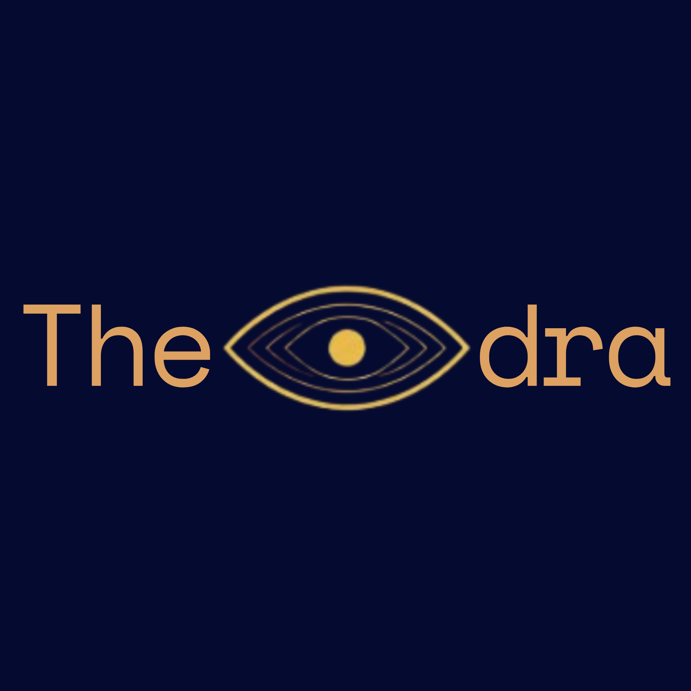

<div align="center">



# THEODRA

**Th**reat & Harassment **E**arly-warning system using **O**bservational **D**ata, **R**isk **A**nalytics

[](https://github.com/ruushhdaa/theodra)
[](https://www.python.org/)
[](https://fastapi.tiangolo.com/)
[](https://react.dev/)
[](https://www.typescriptlang.org/)
[](https://supabase.com/)
[](#privacy-guarantees--k-anonymity)
[](#statutory-compliance-posh-act-2013)
[](LICENSE)

*A privacy-preserving, three-layer early-warning system for workplace harassment under India's POSH Act (Prevention of Sexual Harassment) framework. Surfaces behavioral communication anomalies for Internal Committee (IC) review — without ever inspecting message content or revealing identities below a rigorous $k$-anonymity threshold ($k \ge 5$).*

</div>

---

## Table of Contents

- [About THEODRA](#about-theodra)
- [The Problem: Why Current Solutions Fail](#the-problem-why-current-solutions-fail)
- [Core Architecture & Three-Layer Pipeline](#core-architecture--three-layer-pipeline)
  - [Layer 1: Metadata Anomaly Detection](#layer-1-behavioral-metadata-anomaly-detection)
  - [Layer 2: Privacy-Preserving $k$-Anonymity Layer](#layer-2-k-anonymity-privacy-layer-k--5)
  - [Layer 3: Human-in-the-Loop Governance & Multi-Portal Platform](#layer-3-human-in-the-loop-governance--application-suite)
- [Key Features](#key-features)
  - [1. Anonymous Employee Reporting Portal](#1-anonymous-employee-reporting-portal)
  - [2. Internal Committee (IC) Decision Console](#2-internal-committee-ic-decision-console)
  - [3. HR & Statutory Compliance Administration](#3-hr--statutory-compliance-administration)
- [System Workflow](#system-workflow)
- [Technology Stack](#technology-stack)
- [Repository Structure](#repository-structure)
- [Quickstart & Local Development](#quickstart--local-development)
  - [Prerequisites](#prerequisites)
  - [1. Backend Setup (FastAPI)](#1-backend-setup-fastapi)
  - [2. Database & Auth Setup (Supabase)](#2-database--auth-setup-supabase)
  - [3. Machine Learning Data Pipeline](#3-machine-learning-data-pipeline)
  - [4. Frontend Setup (React + Vite)](#4-frontend-setup-react--vite)
  - [Demo Accounts](#demo-accounts)
- [Privacy & Ethical Safeguards](#privacy--ethical-safeguards)
- [Statutory Compliance (POSH Act 2013)](#statutory-compliance-posh-act-2013)
- [Non-Goals & Explicit Boundaries](#non-goals--explicit-boundaries)
- [Contributing & Code of Conduct](#contributing--code-of-conduct)
- [License](#license)

---

## About THEODRA

Named after **Empress Theodora of Byzantium**, who rose from social marginalization to wield institutional authority to enact historic legal protections and physical refuges for vulnerable women.

THEODRA applies that historical ethos in software architecture: **empower the governing institution with the proactive visibility required to intervene, while strictly protecting vulnerable employees from the burden of surveillance.**

### Foundational Principles

1. **Content-Blind**: THEODRA never reads, records, or models message bodies, email text, attachments, audio, or video. It observes only communication *rhythms* and *structural asymmetries*.
2. **Mathematically Guaranteed Anonymity**: Individual identities and micro-cohorts are mathematically suppressed until a cohort meets a verified $k$-anonymity threshold ($k \ge 5$).
3. **Sole Human Authority**: The system never accuses, disciplines, or automates judgment. All decisions remain strictly with the Internal Committee (IC), and escalations require multi-member consensus.

---

## The Problem: Why Current Solutions Fail

Under India's **Sexual Harassment of Women at Workplace (Prevention, Prohibition and Redressal) Act, 2013 (POSH Act)**, Internal Committees bear statutory responsibility for investigating complaints and recommending remedial actions. However, systemic structural flaws prevent effective prevention:

```
┌────────────────────────────────────────────────────────────────────────┐
│                   THE WORKPLACE HARASSMENT SILENCE GAP                 │
├────────────────────────────────────────────────────────────────────────┤
│  Under-Reporting      Employees fear retaliation, career derailment,   │
│  & Power Dynamics  ── and professional isolation; abuse escalates      │
│                       unnoticed behind closed 1:1 channels.            │
│                                                                        │
│  The Reactive Trap    By law, an IC can only act after a formal written│
│  of the POSH Act   ── complaint is filed. If fear silences the victim, │
│                       the institution remains blind.                   │
│                                                                        │
│  HR-Tech Paperwork    Existing platforms (Keka, Darwinbox, greytHR)    │
│  Automations       ── automate form filing and policy storage, but     │
│                       provide zero proactive detection.                │
│                                                                        │
│  Corporate DLP /      Tuned exclusively for intellectual property      │
│  Surveillance Risks── exfiltration and security leaks; intrusive and   │
│                       harmful to employee trust.                       │
└────────────────────────────────────────────────────────────────────────┘
```

**THEODRA's Wedge**: Bridging the gap upstream of formal litigation by detecting escalating behavioral communication anomalies while guaranteeing mathematically validated privacy.

---

## Core Architecture & Three-Layer Pipeline

```
  Communication Metadata (Synthetic / Multi-Source)
  [ Slack DMs / Channels | 1:1 & Group Emails | Organizational Comms ]
                         │
                         ▼
  ┌─────────────────────────────────────────────────────────────┐
  │ LAYER 1: BEHAVIORAL FEATURE EXTRACTION & ANOMALY DETECTION  │
  │ • Baseline calibrated against Enron structural patterns    │
  │ • Features: 7-day frequency trend, after-hours ratio,      │
  │   role hierarchy asymmetry, latency asymmetry, exclusivity │
  │ • Isolation Forest (200 trees, 5% contamination rate)      │
  │ • Continuous scoring: Watch (80th%) | Elevated | Flagged    │
  └──────────────────────────────┬──────────────────────────────┘
                                 │ Anomaly Scores
                                 ▼
  ┌─────────────────────────────────────────────────────────────┐
  │ LAYER 2: k-ANONYMITY GENERALIZATION & COHORT SUPPRESSION    │
  │ • Quasi-Identifiers: Department, Role Level, Week Bucket    │
  │ • Collapses 5 role tiers to supervisory/non-supervisory    │
  │ • Cohort Suppression: Any cohort with < 5 members is withheld│
  │ • Zero message content ingested or exposed                  │
  └──────────────────────────────┬──────────────────────────────┘
                                 │ Sanitized Cohort Signals
                                 ▼
  ┌─────────────────────────────────────────────────────────────┐
  │ LAYER 3: STATUTORY GOVERNANCE & MULTI-PORTAL WORKSPACE       │
  │ ├── Employee Anonymous Portal (No auth, secure tracking)     │
  │ ├── Internal Committee Console (Multi-vote escalation, timer)│
  │ └── HR Admin Compliance Console (Annual filings, benchmarks) │
  └─────────────────────────────────────────────────────────────┘
```

### Layer 1: Behavioral Metadata Anomaly Detection

- **Real-World Baseline Calibration**: Baseline distributions for message lengths, thread reply latencies, depth, and normal after-hours percentages are calibrated against public organizational datasets (**Enron Email Corpus** structural statistics, never message text).
- **Synthetic Generators**: Source-agnostic generators emit realistic event streams modeled after Slack DMs, Slack channels, direct 1:1 emails, and distributed email threads.
- **Asymmetric Behavioral Features**:
  1. `frequency_7d_trend`: Slope of messaging frequency over a trailing 4-week window (detects escalation vs. constant volume).
  2. `after_hours_ratio`: Proportion of communications sent outside standard operating hours.
  3. `role_asymmetry`: Hierarchical power delta between sender and receiver (`intern` < `junior` < `senior` < `manager` < `IC`).
  4. `latency_asymmetry`: Imbalance in response turnaround times between participants.
  5. `exclusivity_score`: Ratio of private 1:1 interactions relative to shared departmental communication.
  6. `avg_message_length`: Structural length metrics (without semantic analysis).
- **Unsupervised Isolation Forest**: Segmented into three risk tiers (`watch`, `elevated`, `flagged`).

### Layer 2: $k$-Anonymity Privacy Layer ($k \ge 5$)

- **Quasi-Identifier Generalization**: Granular attributes are grouped into generalized tiers (e.g., specific roles collapsed into `supervisory` and `non-supervisory`).
- **Temporal Generalization**: Exact timestamps are bucketed into calendar weeks (`YYYY-Www`) to eliminate timing-correlation attacks.
- **Strict Suppression**: If a flagged pattern's cohort contains fewer than 5 individuals sharing generalized identifiers, the signal is suppressed from human view.

### Layer 3: Human-in-the-Loop Governance & Application Suite

- **Dual-Party Consensus Escalation**: An IC member cannot unilaterally de-anonymize or initiate an investigation from an anomaly signal. A minimum of **two independent IC members** must vote to escalate.
- **Immutable Response Ledger**: Every review, vote, status transition, and rationale is immutably logged for legal compliance and accountability.

---

## Key Features

### 1. Anonymous Employee Reporting Portal
- **Zero Authentication Required**: Complainants can lodge concerns without signing in or linking personal identifiers.
- **Secure Reference Codes**: Submissions generate randomized reference tokens (e.g., `TR-A9F8B2C1`) for anonymous follow-up.
- **Bi-Directional Pseudonymous Chat**: Complainants and IC members can communicate directly while maintaining reporter anonymity.
- **Quiet Flags**: Low-friction department-level flags; an IC alert triggers only when multiple independent flags co-occur in the same department and week.
- **Wellness Pulse & Rights Center**: Quick 1-click sentiment survey and a comprehensive, plain-language POSH Act statutory rights guide.
- **Sanitized Evidence Vault**: Secure attachment upload with MIME-type filtering and storage isolation.

### 2. Internal Committee (IC) Decision Console
- **$k$-Anonymized Pattern Surveillance**: Review high-risk cohorts with visibility into anomaly scores, frequency trends, and exclusivity ratios.
- **Consensus Escalation Voting**: Multi-party voting mechanism enforcing statutory committee governance.
- **Statutory Case Manager**: Dedicated inquiry lifecycle with automated statutory deadline countdowns:
  - **90-Day Inquiry Completion** (POSH Act Section 11(4))
  - **10-Day Inquiry Report Dispatch** (POSH Act Section 13(1))
  - **60-Day Employer Action Implementation** (POSH Act Section 13(4))
- **Interim Relief & Retaliation Tracking**: Log witness testimony, protective reassignments, and potential retaliation indicators.
- **Meeting Minutes & Evidence Search**: Record formal inquiry proceedings with searchable case logs.

### 3. HR & Statutory Compliance Administration
- **Automated POSH Section 21/22 Annual Report**: One-click generation of statutory compliance filings (complaints received, disposed, pending beyond 90 days, workshops conducted).
- **Enterprise Health Benchmark**: Composite health scores evaluating IC response turnaround, training completion, reporting accessibility, and policy freshness.
- **Departmental Wellness Heatmap**: Department-by-department pulse metrics surfacing isolated cultural friction.
- **Internal Committee Roster Verification**: Real-time validation of legal composition (Presiding Officer woman, $\ge 50\%$ women representation, external NGO member).
- **Cryptographic Audit Trail**: Complete, tamper-evident log of all system queries and actions.

---

## System Workflow

```mermaid
sequenceDiagram
    autonumber
    actor Employee as Employee / Reporter
    participant Portal as Anonymous Portal
    participant API as FastAPI Backend
    participant ML as Isolation Forest Pipeline
    participant DB as Supabase (PostgreSQL)
    actor IC as Internal Committee (IC)
    actor HR as HR Administration

    rect rgb(20, 25, 55)
    Note over Employee, Portal: 1. Anonymous Reporting & Signals
    Employee->>Portal: Submit Anonymous Report / Quiet Flag / Pulse
    Portal->>API: POST /api/portal/submit (MIME-checked evidence)
    API->>DB: Store report with Reference Code (TR-XXXX)
    API-->>Employee: Return Reference Code
    end

    rect rgb(25, 35, 70)
    Note over ML, DB: 2. Anomaly Detection & k-Anonymity
    ML->>API: Ingest synthetic comms metadata
    API->>ML: Evaluate feature vector (frequency, after-hours, hierarchy)
    ML-->>API: Anomaly score + severity tier (watch/elevated/flagged)
    API->>API: Apply k-anonymity (k>=5 cohort suppression)
    API->>DB: Record detected_patterns (generalized cohort)
    end

    rect rgb(35, 25, 55)
    Note over IC, DB: 3. Committee Consensus & Inquiry
    IC->>API: GET /api/patterns & /api/reports
    IC->>API: POST /api/patterns/{id}/vote (Member 1 votes)
    IC->>API: POST /api/patterns/{id}/vote (Member 2 votes -> Escalated)
    IC->>API: POST /api/cases (Starts 90-day inquiry clock)
    IC->>Portal: Post pseudonymous message to reporter
    end

    rect rgb(20, 40, 45)
    Note over HR, DB: 4. Governance & Statutory Filing
    HR->>API: GET /api/hr/dashboard & /api/hr/heatmap
    HR->>API: POST /api/hr/annual-report (Section 21/22 disclosure)
    API->>DB: Record audit_log event
    end
```



---

## Technology Stack

| Layer | Technologies |
|---|---|
| **Frontend** | React 19, TypeScript, Vite, Tailwind CSS v4, React Router DOM v7, Recharts, Lucide React |
| **Backend API** | Python 3.12+, FastAPI, Uvicorn, Pydantic v2, Pydantic-Settings |
| **Database & Auth** | Supabase (PostgreSQL), Row-Level Security, JWT (python-jose), Passlib (bcrypt) |
| **Machine Learning** | Scikit-learn (Isolation Forest, StandardScaler), NumPy, Pandas, Joblib |
| **Data Calibration** | Enron Email Corpus structural statistics, Synthetic multi-generator pipeline |
| **Testing & Quality** | Pytest, Pytest-Asyncio, Ruff, Black |
| **Deployment** | Vercel (Frontend SPA), Railway / Nixpacks (FastAPI Backend) |

---

## Repository Structure

```
theodra/
├── .env.example              # Template environment configuration
├── Procfile                  # Production process deployment descriptor
├── railway.toml              # Railway nixpacks deployment configuration
├── requirements.txt          # Production backend dependencies
├── requirements-dev.txt      # Development and testing dependencies
├── theodra-logo.png          # Official brand logo
│
├── frontend/                 # React 19 + TypeScript + Vite SPA
│   ├── src/
│   │   ├── api/              # Axios/Fetch API client bindings
│   │   ├── components/       # Layouts (Public, IC, HR) and UI components
│   │   ├── context/          # Auth and global application state
│   │   ├── pages/
│   │   │   ├── public/       # Landing, How It Works, Problem, About
│   │   │   ├── report/       # Anonymous portal, tracker, quiet flag, rights
│   │   │   ├── ic/           # Patterns, cases, 90-day clock, ledger, minutes
│   │   │   ├── hr/           # Dashboard, Section 21/22 annual report, roster
│   │   │   └── legal/        # Terms, Privacy Policy, Cookie Policy
│   │   ├── App.tsx           # Route registry and access guard orchestration
│   │   └── index.css         # Tailwind CSS styling tokens
│   └── package.json          # Frontend dependencies and scripts
│
├── src/                      # Backend application package
│   ├── api/
│   │   ├── auth.py           # JWT token issuance, verification, role guards
│   │   ├── config.py         # Pydantic environment configuration
│   │   ├── database.py       # Supabase client connector
│   │   ├── main.py           # FastAPI routes, error handlers, CORS setup
│   │   └── model.py          # Isolation Forest inference and scoring wrapper
│   ├── generators/
│   │   ├── schema.py         # CommEvent schema & ChannelType / RoleLevel enums
│   │   └── __init__.py
│   ├── model/                # Pipeline training hooks
│   └── privacy/              # k-anonymity validation modules
│
├── scripts/                  # Data engineering, training & seeding scripts
│   ├── 01_download_datasets.py   # Fetch Enron structural dataset
│   ├── 02_extract_enron.py       # Parse email headers and metadata
│   ├── 03_compute_baselines.py   # Compute baseline organizational distributions
│   ├── 04_generate_synthetic.py  # Generate synthetic org-comms with anomalies
│   ├── 05_train_model.py         # Train Isolation Forest & export thresholds
│   ├── create_tables.sql         # Supabase PostgreSQL DDL schema
│   ├── run_create_tables.py      # Automated table initializer
│   └── seed_demo_users.py        # Seed default IC and HR test credentials
│
├── models/                   # Serialized ML artifacts
│   ├── feature_scaler.pkl    # Pre-fitted StandardScaler
│   ├── isolation_forest.pkl  # Trained Isolation Forest model
│   └── thresholds.json       # Calibrated percentile cutoffs (watch/elevated/flagged)
│
├── docs/                     # Specifications and technical design notes
│   └── spec.md               # Core system specification, threat model & literature
│
└── tests/                    # Automated test suites
    └── test_schema.py        # Schema validation and event generation tests
```

---

## Quickstart & Local Development

### Prerequisites

- **Python 3.12+**
- **Node.js 20+** and **npm**
- A **Supabase** project (or local PostgreSQL instance with `uuid-ossp`)

---

### 1. Backend Setup (FastAPI)

1. **Clone repository and create virtual environment**:
   ```bash
   git clone https://github.com/ruushhdaa/theodra.git
   cd theodra
   python -m venv .venv

   # Activate virtualenv
   # On macOS/Linux:
   source .venv/bin/activate
   # On Windows:
   .venv\Scripts\activate
   ```

2. **Install Python dependencies**:
   ```bash
   pip install -r requirements.txt
   pip install -r requirements-dev.txt
   ```

3. **Configure Environment Variables**:
   Copy `.env.example` to `.env` and fill in your Supabase credentials:
   ```bash
   cp .env.example .env
   ```
   Ensure `.env` contains:
   ```env
   SUPABASE_URL=https://your-project.supabase.co
   SUPABASE_ANON_KEY=your-supabase-anon-key
   SUPABASE_SERVICE_KEY=your-supabase-service-role-key
   JWT_SECRET_KEY=generate-a-secure-random-secret
   FRONTEND_URL=http://localhost:5173
   ```

4. **Start the FastAPI backend server**:
   ```bash
   uvicorn src.api.main:app --host 127.0.0.1 --port 8000 --reload
   ```
   The interactive Swagger documentation will be available at: [http://localhost:8000/docs](http://localhost:8000/docs).

---

### 2. Database & Auth Setup (Supabase)

1. In your Supabase project dashboard, open the **SQL Editor**.
2. Run the SQL script located in [`scripts/create_tables.sql`](scripts/create_tables.sql) to create all required tables (`users`, `anonymous_reports`, `report_messages`, `detected_patterns`, `cases`, `audit_log`, `wellness_pulse`, etc.).
3. Seed the default demo users into your database:
   ```bash
   python scripts/seed_demo_users.py
   ```

---

### 3. Machine Learning Data Pipeline

To re-run the synthetic data generation and re-train the Isolation Forest anomaly detector:

```bash
# 1. Download reference corpus metadata
python scripts/01_download_datasets.py

# 2. Extract structural metrics from Enron corpus
python scripts/02_extract_enron.py

# 3. Compute empirical baseline distributions
python scripts/03_compute_baselines.py

# 4. Generate 10,000 synthetic communication pairs with 5% injected anomalies
python scripts/04_generate_synthetic.py

# 5. Train Isolation Forest and export scaler + model + thresholds
python scripts/05_train_model.py
```

The resulting model artifacts will be saved to `models/` (`isolation_forest.pkl`, `feature_scaler.pkl`, `thresholds.json`).

---

### 4. Frontend Setup (React + Vite)

1. Open a new terminal and navigate to the frontend directory:
   ```bash
   cd frontend
   npm install
   ```

2. Configure frontend environment variables:
   Create `frontend/.env.local` (or verify it exists):
   ```env
   VITE_API_URL=http://localhost:8000
   ```

3. Launch the Vite development server:
   ```bash
   npm run dev
   ```
   Open [http://localhost:5173](http://localhost:5173) in your browser.

---

### Demo Accounts

Use these pre-configured credentials to explore the authenticated interfaces:

| Role | Portal URL | Email | Password | Primary Capabilities |
|---|---|---|---|---|
| **IC Member** | `/ic/login` | `ic@theodra.demo` | `demo1234` | Pattern review, consensus voting, 90-day case clocks, report chat |
| **HR Admin** | `/hr/login` | `hr@theodra.demo` | `demo1234` | Section 21/22 annual reporting, health scores, audit log, ICC roster |
| **Employee** | `/report` | *No auth required* | *N/A* | Anonymous complaint filing, token tracker, quiet flags, pulse survey |

---

## Privacy & Ethical Safeguards

THEODRA was designed from the first commit around strict ethical bounds:

- **Zero Content Inspection**: No NLP, sentiment analysis of text, topic modeling, or attachment reading. Harassment is identified exclusively through *relational, structural dynamics* (e.g., escalating after-hours frequency from a senior to a junior paired with collapsing reply latency).
- **$k$-Anonymity by Construction ($k \ge 5$)**: Human reviewers cannot view anomalous communication patterns unless at least 5 individuals fall into the same generalized bracket.
- **Protection Against Stylometric deanonymization**: The anonymous report portal advises reporters on removing identifying lexical idiosyncrasies, strips metadata from uploaded files, and does not retain IP addresses or browser fingerprints.
- **Auditability**: Every query, report view, status change, and escalation vote is logged with pseudonymous actor IDs in `audit_log`.

---

## Statutory Compliance (POSH Act 2013)

THEODRA natively supports the procedural requirements of the **Indian POSH Act (2013)**:

```
┌────────────────────────────────────────────────────────────────────────┐
│               POSH ACT 2013 STATUTORY INQUIRY TIMELINE                │
├────────────────────────────────────────────────────────────────────────┤
│  Day 0        Complaint filed or pattern escalated by consensus       │
│               Formal notice issued; conciliation offered (Sec 10)      │
│                                                                        │
│  Day 1–90     Formal Inquiry Period (Sec 11(4))                        │
│               Active countdown clock in IC Console                     │
│               Interim relief logged; witness testimonies documented    │
│                                                                        │
│  Day 90–100   Inquiry Report Submission (Sec 13(1))                    │
│               IC report must be submitted to employer within 10 days   │
│                                                                        │
│  Day 100–160  Employer Implementation (Sec 13(4))                      │
│               Employer has 60 days to act upon IC recommendations      │
│                                                                        │
│  Annual       Section 21/22 Statutory Filing                           │
│               Automatic generation of annual compliance disclosure     │
└────────────────────────────────────────────────────────────────────────┘
```

---

## Non-Goals & Explicit Boundaries

To prevent misuse or mission creep, THEODRA establishes explicit non-goals:

1. **Not an Automated Judge**: The system never determines guilt, labels someone a harasser, or recommends disciplinary action. It only surfaces structural anomalies for human Internal Committee scrutiny.
2. **Not a General Employee Monitoring Tool**: THEODRA cannot be repurposed for keystroke logging, productivity tracking, screenshotting, or sentiment surveillance.
3. **Synthetic Calibration Only in Current Phase**: Current models are trained and calibrated on synthetic datasets grounded in academic research baselines. Production deployment on real organizational communications requires independent legal, privacy, and ethics review.
4. **Does Not Replace Formal Complaints**: Early warnings complement, rather than substitute for, statutory complaint procedures required under applicable law.

---

## Testing & Quality Assurance

Run the test suite to verify event generation and schema validation:

```bash
# Run pytest with asyncio support
pytest

# Run code style and linting checks
black --check src/ tests/
ruff check src/ tests/

# Run frontend TypeScript type checking
cd frontend && npm run build
```

---

## Contributing & Code of Conduct

We welcome academic, legal, and open-source contributions.

1. Review [CONTRIBUTING.md](CONTRIBUTING.md) for branch naming standards, commit conventions, and mandatory privacy guidelines.
2. Ensure any modifications to privacy thresholds ($k$-anonymity) or data schemas include an accompanying rationale in `docs/spec.md`.
3. Never commit real corporate communication datasets or personally identifiable information.

---

## License

This project is licensed under the **MIT License** — see the [LICENSE](LICENSE) file for details.

> *Note: THEODRA is an academic and research system built on synthetic data. Organizations seeking to implement early-warning mechanisms must ensure compliance with their local labor laws, privacy regulations (such as DPDP Act 2023), and constitutional protections.*
